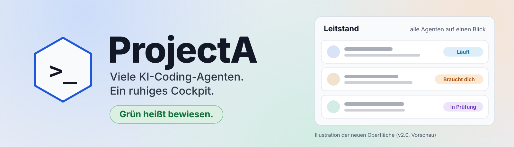
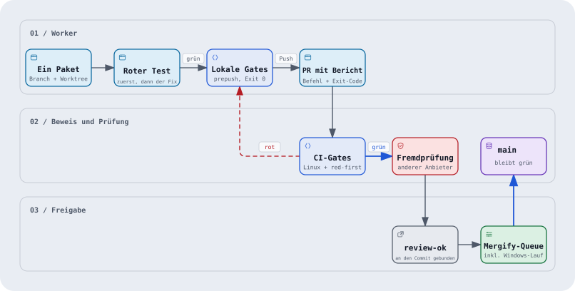
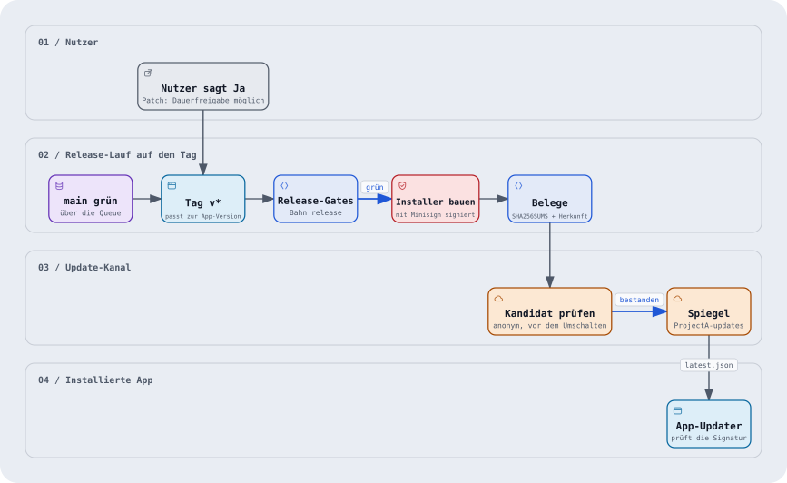
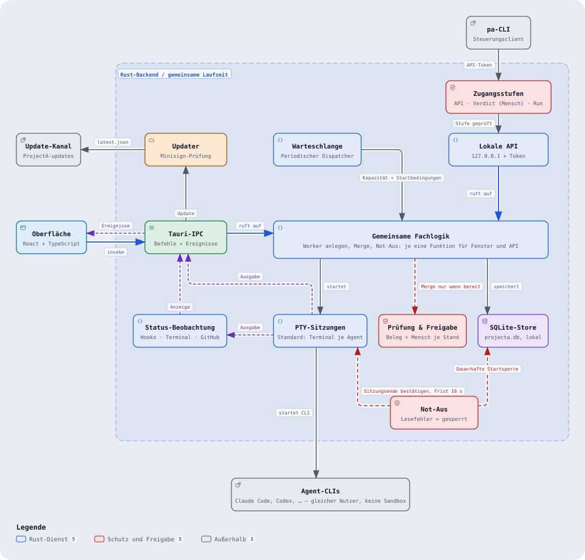

# ProjectA

<div align="center">
  <picture>
    <source media="(prefers-color-scheme: dark)" srcset="assets/banner-dark.svg" />
    
  </picture>

  <h3>Viele KI-Coding-Agenten. Ein ruhiges Cockpit. Grün heißt bewiesen.</h3>

  <p><em>An agentic terminal for Windows: many AI coding agents, one calm cockpit — and nothing counts as done until it is proven.</em></p>

  <a href="https://github.com/Cuarroc/ProjectA-updates/releases/latest"></a>
  <a href="https://github.com/Cuarroc/ProjectA/actions/workflows/ci.yml?query=branch%3Amain"></a>
  
  
  <a href="LICENSE"></a>

  <p>
    <a href="#schnellstart"><strong>Schnellstart</strong></a> ·
    <a href="#so-arbeitet-projecta"><strong>So arbeitet ProjectA</strong></a> ·
    <a href="#so-ist-projecta-gebaut"><strong>Aufbau</strong></a> ·
    <a href="#funktionen"><strong>Funktionen</strong></a> ·
    <a href="#die-neue-oberfläche-v20"><strong>v2.0</strong></a> ·
    <a href="#für-entwickler"><strong>Für Entwickler</strong></a>
  </p>
</div>

---

## In 30 Sekunden

| | |
| --- | --- |
| **Was ist das?** | Ein Windows-Programm, in dem mehrere KI-Coding-Agenten **gleichzeitig** für dich arbeiten: jeder in seinem eigenen Terminal, mit eigenem Git-Branch und eigenem Worktree. Du siehst alles in einem Fenster und behältst die Kontrolle: Not-Aus, Budgetgrenzen und ein lückenloses Protokoll. |
| **Warum „Grün heißt bewiesen“?** | Ein Agent, der „fertig“ meldet, hat noch nichts bewiesen. In ProjectA zählt, was ein roter Test, die echte Prüfbahn und bei Code ein Prüfer eines anderen Anbieters bestätigt haben. [So läuft das ab](#so-arbeitet-projecta) |
| **Wie starte ich?** | Installer von der [Release-Seite](https://github.com/Cuarroc/ProjectA-updates/releases/latest) laden, eine Agent-CLI anmelden, Projekt hinzufügen. [Schnellstart](#schnellstart) |
| **Wo lese ich weiter?** | [Funktionen](#funktionen) · [Aufbau](#so-ist-projecta-gebaut) · [Glossar](docs/hilfe/glossar.md) · [Dokumentation](#dokumentation) |

> **Unser Grundsatz:** Fertig ist nur, was bewiesen ist. Grün heißt: Die Tests
> liefen wirklich. Kein Modell prüft sich selbst. Was zählt, entscheidet der
> Mensch.

## Warum ProjectA?

<table>
  <tr>
    <td width="33%" valign="top">
      <h4>⚡ Parallel statt nacheinander</h4>
      Jede Aufgabe wird ein eigener Worker mit eigenem Branch und Worktree.
      Die Agenten kommen sich nicht in die Quere, und du wartest nicht auf einen
      nach dem anderen.
    </td>
    <td width="33%" valign="top">
      <h4>🛡️ Du behältst die Kontrolle</h4>
      Ein Not-Aus stoppt binnen zehn Sekunden alle Agenten, auch über Neustarts.
      Budgetgrenzen und Rollen legen fest, was ein Agent darf und wie viel er
      verbrauchen darf.
    </td>
    <td width="33%" valign="top">
      <h4>🔍 Nachvollziehbar und lokal</h4>
      Laufzeitdaten liegen in einer lokalen SQLite-Datenbank. Vor jeder
      Migration entsteht ein Backup. Du siehst jederzeit, wer was gemacht hat.
    </td>
  </tr>
</table>

**Deine Agenten, deine Zugänge:** ProjectA startet die Agent-CLIs, die du schon
nutzt, zum Beispiel Claude Code, Codex CLI, Kimi CLI, OpenCode oder Ollama. Es
bringt kein eigenes Modell und keine Anbieterzugänge mit.

## So arbeitet ProjectA

Auftrag, Arbeit, Beweis, Fremdprüfung, Freigabe und Ausliefern sind **ein**
Ablauf. Jeder Schritt hinterlässt einen Beleg.

<p align="center">
  <picture>
    <source media="(prefers-color-scheme: dark)" srcset="docs/assets/readme/ablauf-dark.svg" />
    
  </picture>
</p>

1. **Ein Paket:** eine Aufgabe, ein Branch, ein Agent, ein Worktree, ein PR.
2. **Roter Test zuerst:** bei einem Fehler entsteht erst ein fehlschlagender
   Test, dann der Fix.
3. **Lokale Gates:** „Grün“ heißt, dass die Prüfbahn `prepush` im eigenen
   Worktree mit Exit 0 endet.
4. **PR mit Bericht:** Der PR-Text nennt Befehle, Exit-Codes und, was **nicht**
   abgedeckt ist (`NICHT ABGEDECKT`).
5. **CI und Fremdprüfung:** Der Linux-Lauf und `red-first` laufen in der CI;
   nach Risiko prüft ein Modell, das nicht aus der Familie des Autors stammt.
6. **Freigabe und Queue:** Nur mit `review-ok` kommt ein PR in die
   Mergify-Queue. Dort läuft auch der Windows-Lauf. Gemergt wird nur über die
   Queue.

Die verbindlichen Regeln stehen in [`AGENTS.md`](AGENTS.md), die lokalen Gates in
[`docs/ci-lokal.md`](docs/ci-lokal.md).

### Vom Merge bis zum signierten Update

Ein Release braucht das Ja des Nutzers (bei Patch-Releases kann eine schriftliche
Dauerfreigabe es ersetzen). Danach prüft der Release-Lauf auf dem Tag, signiert
die Installer und stellt das Update erst um, wenn der Kandidat anonym geprüft
wurde.

<p align="center">
  <picture>
    <source media="(prefers-color-scheme: dark)" srcset="docs/assets/readme/release-dark.svg" />
    
  </picture>
</p>

## Schnellstart

1. **Installieren:** den Installer `ProjectA_<Version>_x64-setup.exe` von der
   [Release-Seite](https://github.com/Cuarroc/ProjectA-updates/releases/latest)
   laden und ausführen. Spätere Updates kommen über den eingebauten, mit
   Minisign signierten Updater.
2. **Agent einrichten:** mindestens eine Agent-CLI installieren und dort
   anmelden. Die Einrichtung je Anbieter steht unter
   [`docs/setup/`](docs/setup/README.md).
3. **Projekt hinzufügen:** in ProjectA links unter „Projekte“ mit „+“ ein
   Git-Repository wählen.
4. **Loslegen:** mit „Neuer Worker“ eine Aufgabe beschreiben und ein
   Agenten-Profil wählen. Den Fortschritt zeigen Board, Terminal und Diff.

Unbekannte Begriffe erklärt das [Glossar](docs/hilfe/glossar.md); die
wichtigsten Handgriffe stehen im [Spickzettel](docs/hilfe/spickzettel.md).

## Funktionen

| | Funktion | Was sie tut |
| --- | --- | --- |
| **Arbeiten** | Agenten-Terminals | Jeder Worker läuft in einem echten Terminal (PTY) mit eigenem Verlauf. |
| | Worktree je Aufgabe | Eigener Branch und Git-Worktree pro Worker. |
| | Board und Warteschlange | Aufgaben einreihen; gestartet wird erst, wenn Kapazität frei ist. |
| | Orchestrator-Chat | Wünsche in Worte fassen; der Orchestrator verteilt die Arbeit. |
| **Prüfen** | Diff und Review | Änderungen eines Workers ansehen und zeilenweise kommentieren. |
| | Learnings | Was Agenten im Projekt gelernt haben; ein Mensch gibt es frei. |
| **Kontrolle** | Not-Aus | Beendet alle Agenten-Sitzungen (Frist 10 s, das Ende wird bestätigt) und sperrt neue Aufträge dauerhaft, auch über Neustarts. |
| | Budget und Rollen | Schwellen auf die Nutzungsfenster der Anbieter; Rechte je Rolle. |
| **Unterwegs** | Web-Interface | Board und Learnings nur lesend im Browser, etwa auf dem Handy. |
| | Sitzungen wiederherstellen | Verlauf und Entwürfe überstehen einen Neustart (höchstens 7 Tage). |
| **Automatisieren** | Kommandozeile `pa` | Spricht mit der laufenden App über eine lokale, per Token geschützte API. |

### Denkraum

Der Denkraum ist eine lokale Browserseite für Menschen: Fragen der Agenten
beantworten, Ideen sammeln und deren Bearbeitungsstand lesen, ganz ohne
Programmierkenntnisse. Er ist nur auf deinem Rechner unter
`http://127.0.0.1:4791/` erreichbar, kein öffentliches Webangebot. Eine
gespeicherte Antwort oder Idee startet noch keine Ausführung.
Die [Anleitung in fünf Schritten](docs/denkraum/ANLEITUNG.md) führt durch
Start, Antwort, Status, Stoppen und Sichern.

## So ist ProjectA gebaut

Die React-Oberfläche spricht über die Tauri-IPC mit dem Rust-Backend, die
Kommandozeile `pa` (ein Steuerungsclient für Menschen, Skripte und
Orchestratoren) über eine lokale API. Beide Wege rufen für „Worker anlegen“,
„Merge“ und „Not-Aus“ dieselben Funktionen auf, aber mit verschiedenen Rechten:
Die API kennt ein API-Token, ein Verdict-Token für Freigaben und eng begrenzte
Zugänge für einzelne Läufe. Worker laufen im Standardweg in einem echten
Terminal (PTY) für deine Agent-CLI; die Warteschlange startet sie periodisch,
sobald Kapazität und die weiteren Startbedingungen passen.

Anzeige und Freigabe sind getrennt. Die Status-Beobachtung leitet die
Board-Spalte aus Agent-Hooks, Terminalausgabe, Ruhezeiten und GitHub-Fakten ab;
das ist eine Anzeige, kein Beweis. Ob ein Worker gemergt werden darf, rechnet die
Prüfung aus Git-Stand, der Freigabe eines Menschen und – falls ein Testbefehl
eingerichtet ist – bestandenen Tests aus, gebunden an genau den Code-Stand, der
gemergt würde. Fehlen die jeweils erforderlichen Belege, lehnt der Merge ab.

Der Not-Aus setzt eine dauerhafte Startsperre in SQLite (sie bleibt nach einem
Neustart, ein Lesefehler gilt als „gesperrt“) und beendet die Sitzungen. Er
meldet „gestoppt“ erst, wenn er das Sitzungsende beobachtet hat; dafür gilt eine
Frist von 10 s. Eine gemessene Gesamtdauer vom Klick bis zum Ende gibt es nicht.
Updates holt der eingebaute Updater vom Update-Kanal und prüft sie per Minisign.

<p align="center">
  <picture>
    <source media="(prefers-color-scheme: dark)" srcset="docs/assets/readme/architektur-dark.svg" />
    
  </picture>
</p>

„Lokal“ meint Steuerung und Laufzeitdaten: Die SQLite-Datei liegt auf deinem
Rechner, die API lauscht nur auf 127.0.0.1. Die Agent-CLIs sprechen weiterhin
mit ihren Anbietern; ein Offline-Betrieb ist damit nicht gemeint. Das
Rust-Backend ist eine gemeinsame Laufzeit, keine Sicherheits-Sandbox: Die
Agent-CLIs laufen unter demselben Betriebssystem-Nutzer wie die App, Worktrees
trennen nur Arbeitsstände, keine Rechte.

Das Bild zeigt den Standardweg über PTY. Daneben gibt es einen nativen
Windows-Pfad für Codex; ihn erreicht nur der Planer des ausgeschalteten
Dauerbetriebs. Die Diagramme stammen aus Belegen im Quellcode. Die Quellen
liegen unter [`docs/diagrams/`](docs/diagrams/README.md): je Kasten Datei und
Zeilen, dazu die festgehaltene Revision. Pfeile tragen keine eigenen Belege, sie
stehen auf dem aufrufenden Kasten.

## Die neue Oberfläche (v2.0)

ProjectA bekommt eine neue, ruhige Glas-Oberfläche: aus 25 Ansichten werden
10 klare Bildschirme, in hell und dunkel, mit echten Daten hinter jedem Knopf.
Sie entsteht schrittweise und in drei Releases:

| Release | Inhalt |
| --- | --- |
| **v2.0** | Neue Hülle und **Leitstand**: alle Agenten auf einen Blick, mit Grund, Alter und Auftrag; die neue Oberfläche wird Standard und bleibt jederzeit zurückschaltbar. |
| **v2.1** | Start, Beweise, Kontingente und der Verlauf. |
| **v2.2** | Der übrige Umfang. |

Schon heute kannst du sie ausprobieren: **Einstellungen › Allgemein ›
„Neue Oberfläche (Vorschau)“**. Die Kurzfassung des Plans steht in
[`docs/roadmap-2.0.md`](docs/roadmap-2.0.md), der vollständige Plan in
[`docs/plan/v2.0/plan.md`](docs/plan/v2.0/plan.md).

## Status und Grenzen

- **App-Version:** `v1.6.6` – diese Version baut der Quellcode auf `main`.
- **Veröffentlicht:** Die jüngste Version zeigen das Badge oben und die
  [Release-Seite](https://github.com/Cuarroc/ProjectA-updates/releases/latest).
  Was sich ändert, steht im [`CHANGELOG.md`](CHANGELOG.md).
- Aktives persönliches Projekt. **Windows** ist das einzige paketierte Ziel;
  plattformneutrale und Linux-spezifische Prüfungen laufen zusätzlich unter
  Linux beziehungsweise WSL2. Ein Linux- oder macOS-Paket gibt es nicht.
- Der automatische Dauerbetrieb (Continuous) ist ausgeschaltet. Er wird erst
  nach belegter Abnahme und nur durch den Menschen freigegeben.
- Agent-CLIs und Anbieterzugänge bringst du selbst mit.
- Interne Projektunterlagen sind überwiegend auf Deutsch.

## Mitmachen als Tester

Installiere die aktuelle Version von der
[Release-Seite](https://github.com/Cuarroc/ProjectA-updates/releases/latest)
und arbeite die kurze Klickliste in [`docs/TESTEN.md`](docs/TESTEN.md) durch.
Deine Beobachtungen meldest du am besten über die Issue-Vorlage
„Tester-Feedback“; sie fragt genau das ab, was wir zur Fehlersuche brauchen.

## Dokumentation

| | |
| --- | --- |
| [`docs/setup/`](docs/setup/README.md) | Agent-CLIs und Anbieter einrichten |
| [`docs/hilfe/glossar.md`](docs/hilfe/glossar.md) | Begriffe einfach erklärt |
| [`docs/drills/`](docs/drills/README.md) | Prüfabläufe für die installierte App |
| [`CHANGELOG.md`](CHANGELOG.md) | Änderungen je Version |
| [`KNOWN_ISSUES.md`](KNOWN_ISSUES.md) | Bekannte offene Befunde |
| [`SECURITY.md`](SECURITY.md) | Sicherheitslücken vertraulich melden |

## Für Entwickler

ProjectA ist mit [Tauri 2](https://v2.tauri.app/) gebaut: Ein Rust-Kern
verwaltet die Laufzeitdaten in SQLite, die Oberfläche ist React mit
TypeScript. An diesem Repository arbeiten Menschen und mehrere KI-Agenten
parallel, deshalb sind die Regeln streng und überall gleich.

<details>
<summary><strong>Voraussetzungen</strong></summary>

- Node.js 24 oder neuer
- Rust 1.89 oder neuer (stable) und Cargo
- Git; für den vollständigen PR-Ablauf außerdem die GitHub CLI `gh`
- die [Tauri-2-Voraussetzungen für Windows](https://v2.tauri.app/start/prerequisites/)
- mindestens eine lokal eingerichtete Agent-CLI, wenn echte Worker gestartet
  werden sollen

Die anbieterspezifische Einrichtung steht unter
[`docs/setup/`](docs/setup/README.md).

</details>

<details>
<summary><strong>Lokal einrichten und prüfen</strong></summary>

```sh
npm ci
npm run dev:doctor                 # nur Diagnose, verändert nichts
npm run dev:agent-check            # prüft die Agent-Entwicklungsumgebung
bash scripts/ci/doctor.sh           # zeigt, was diese Maschine belegen kann
bash scripts/ci/gates.sh --list     # aktuelle Gate-Liste
bash scripts/ci/gates.sh lane prepush
```

`prepush` ist die vollständige lokale Prüfbahn. Sie umfasst unter anderem
TypeScript-, Frontend-, HQ- und Rust-Prüfungen; die verbindliche Liste lebt nur
in `scripts/ci/gates.sh`. Kein einzelner Rechner deckt sowohl die
Windows- als auch die Linux-spezifischen Tests ab. Jeder Gate-Lauf nennt das
im Block `NICHT ABGEDECKT`; Details stehen in
[`docs/ci-lokal.md`](docs/ci-lokal.md).

`npm run dev:setup` richtet die Clone-lokalen Git-Hooks ein und erzeugt
`.pa/HQ-START.md`. Das ist eine bewusste schreibende Einrichtung und daher
nicht Teil der reinen Diagnose oben.

Die Desktop-App wird mit `npm run tauri dev` gestartet. Dabei können vorhandene
Queue-Einträge echte Agenten starten. Starte sie deshalb nur bewusst; für eine
Entwicklungssitzung ohne Dispatcher kann `PROJECTA_QUEUE=off` gesetzt werden.

</details>

<details>
<summary><strong>Sicher beitragen</strong></summary>

1. Vor Beginn `STAND.md` und `docs/PLAN.md` lesen und den Live-Stand von
   `origin/main` und den offenen Pull Requests prüfen.
2. Pro Paket einen eigenen Branch und Worktree verwenden; fremde Änderungen
   nicht übernehmen oder verwerfen.
3. Für Fehler zuerst einen kompilierenden, fehlschlagenden Regressionstest
   hinzufügen. Reine Dokumentationsänderungen sind davon ausgenommen.
4. Vor jedem Commit den Secret-Scan und vor dem Push die vollständige
   `prepush`-Bahn im eigenen Worktree erfolgreich ausführen. Hooks nie umgehen.
5. Den Branch pushen, den Push gegen den Remote-Stand prüfen und einen
   Draft-PR mit Befehlen, Exit-Codes, Review-Ergebnissen und
   `NICHT ABGEDECKT`-Block eröffnen.
6. `main` nur über die Mergify-Queue zusammenführen; nicht rebasen oder
   force-pushen.

Die vollständigen, verbindlichen Regeln stehen in [`AGENTS.md`](AGENTS.md).

</details>

<details>
<summary><strong>Orientierung im Repository</strong></summary>

| Datei | Zweck |
| --- | --- |
| [`AGENTS.md`](AGENTS.md) | Verbindliche Arbeits-, Prüf- und PR-Regeln |
| [`STAND.md`](STAND.md) | Kurzer aktueller Projektstand |
| [`docs/PLAN.md`](docs/PLAN.md) | Einziger Plan: Meilensteine, geparkte Arbeit und Entscheidungen |
| [`docs/decisions.md`](docs/decisions.md) | Entscheidungen mit Begründung und Rückweg |
| [`KNOWN_ISSUES.md`](KNOWN_ISSUES.md) | Bekannte offene Befunde |
| [`docs/setup/README.md`](docs/setup/README.md) | Einrichtung der Agent-Werkzeuge |
| [`docs/ci-lokal.md`](docs/ci-lokal.md) | Lokale Gates und Plattformgrenzen |
| [`SECURITY.md`](SECURITY.md) | Vertrauliches Melden von Sicherheitslücken |

</details>

## Lizenz

ProjectA steht unter der [MIT-Lizenz](LICENSE). Hinweise zu eingebundener
Drittsoftware stehen in
[`docs/THIRD_PARTY_NOTICES.md`](docs/THIRD_PARTY_NOTICES.md).
