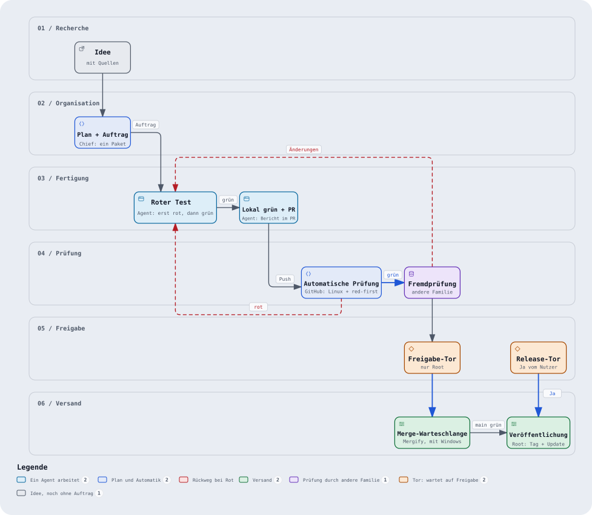
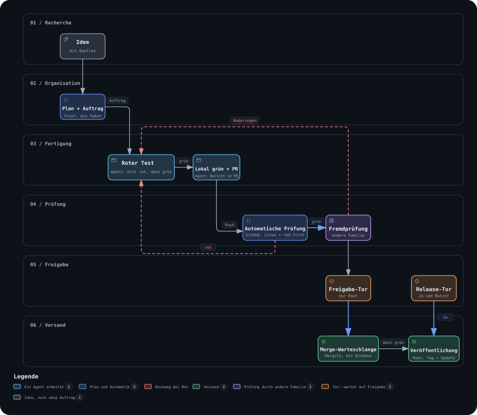

# Fabrik design (2026-10)

This folder holds the diagram of the Fabrik track ("Strecke") and nothing
else. The design system itself is not copied into the repo: tokens, colours,
motion and components live in a Claude artifact, which is the source of truth.

## Design system

- **ProjectA Fabrik** (source of truth):
  <https://claude.ai/artifact/MNs7Me9VU95kTkiz2Qig56>. Private artifact; access
  goes through the owner.
- **Glass** (parent system of Fabrik):
  <https://claude.ai/artifact/9iH3yXi2RFc6GrXXpCptaB>.

## Files

| File | What it is |
|---|---|
| `fabrik-strecke.workflow.json` | Archify source of the diagram |
| `fabrik-strecke-light.svg` | Rendered diagram, light theme |
| `fabrik-strecke-dark.svg` | Rendered diagram, dark theme |

## Rebuilding the SVGs

The exporter is [`docs/diagrams/export-svg.mjs`](../../diagrams/export-svg.mjs).
It renders an Archify HTML diagram with the ProjectA tokens and has a
`contrast` mode that checks every text colour against its real background
(WCAG ratio of at least 4.5:1). Usage is in the header of that file.

## Open design decisions

They are not listed here; see the decision inbox in
[`docs/PLAN.md`](../../PLAN.md).
